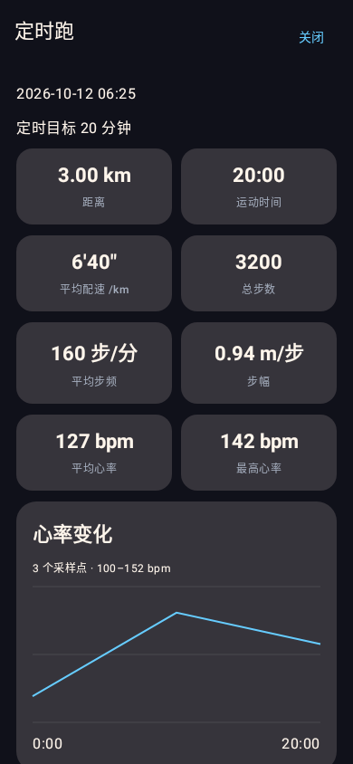

# 洛天依陪跑 · Android 原生版

洛天依语音、音乐与节拍器，陪你迈出每一步。

基于 [Cory 的洛天依陪跑](https://github.com/w8888-hh/luotianyi-running-app) 重写的 Android 原生版，使用 **Kotlin + Jetpack Compose** 开发。原生版作者：**绿卫**；原项目作者：**Cory**。

本仓库是原项目的 **fork**，保留上游代码和提交历史。原生版源码位于 [`android-native/`](android-native/)，原项目 Web 代码仍保留在仓库中。

**当前版本：v1.0.0** · Android 8.0 及以上

[下载 APK](https://github.com/lvwei114/luotianyi-running-app/releases/tag/v1.0.0) · [观看介绍视频](https://github.com/lvwei114/luotianyi-running-app/releases/download/v1.0.0/Luotianyi-Running-v1.0.0-intro.mp4) · [更新说明](android-native/docs/v1.0.0更新说明.md) · [构建说明](android-native/README.md)

## 核心功能

- **四种跑法**：跟天依跑、天依跟你跑、自定义 BPM，以及 5–60 分钟定时跑。定时跑在首页直接选择，暂停不计时，到点自动结束。
- **GPS 与训练记录**：距离与实时配速并排显示，静止时配速显示 `--`；记录距离仅使用有效 GPS 数据，定位缺失路段不补算。提供平均步频、平均步幅、心率曲线、历史与本周统计。
- **天依语音陪伴**：59 条本地语音，匹配字幕与情境触发，支持分类试听。涵盖开跑、阶段提示、鼓励、补水与心率提醒；“天依说”固定显示在屏幕上方。
- **音乐与节拍器**：批量导入本地歌曲，新建或追加歌单，BPM 检测与匹配、顺序／随机／心率智能播放。引导跑与定时跑使用平滑的四阶段 BPM 曲线。
- **问候与连续运动奖励**：首页问候语随时间变化，显示昵称、连续天数与状态图标；每连续运动 5 天出现里程碑祝贺弹窗。
- **安卓原生与后台运行**：支持前台运动服务、锁屏通知与音乐控制、中断训练恢复和保存失败重试。使用 Room、DataStore 与 Media3，运动记录和设置保存在本机。
- **个性化界面**：内置图库、自选背景与头像，完整／简洁／省电效果档位，主题色 `#66CCFF`。

## 界面预览

以下截图由当前 **v1.0.0** 原生界面重新渲染生成；运动记录与连续天数为示例数据。

| 首页 | 定时跑 | 运动界面 |
| --- | --- | --- |
|  |  |  |

| 记录详情 | 天依语音 | 音乐歌单 |
| --- | --- | --- |
|  |  |  |


## 安装与使用

1. 在 [v1.0.0 Release](https://github.com/lvwei114/luotianyi-running-app/releases/tag/v1.0.0) 下载 APK。页面另附 SHA256 校验文件与 60 秒介绍视频。
2. 安装后，按需允许定位、身体活动、蓝牙和通知权限。GPS 距离需要有效定位，心率功能需要支持标准 BLE 心率广播的设备。
3. 在音乐页导入本地歌曲，然后在首页选择跑法并开始训练。
4. 训练完成后，在“记录”页查看详情与统计。

v1.0.0 使用与此前原生测试版一致的**调试签名**，可覆盖更新同签名的旧版本。自行编译的签名可能不同。

## v1.0.0 更新重点

- 版本名更新为 `1.0.0`，移除 `native-test` 标记；修复设置页显示旧版本号的问题。
- 定时跑整合进首页四种跑法选择，选择后显示 5–60 分钟时长设置。
- 新增连续运动状态图标和每 5 天的祝贺弹窗；同一天多次训练只计一天，同一里程碑确认后不重复提醒。
- 优化图标清晰度，更换应用图标；“继续加油”按钮放大并居中。

69 项 JVM／Robolectric 测试通过；Lint 0 错误、18 条提示。已核对 APK 版本、资源、完整性、SHA256 和 v2 签名。详见 [更新说明](android-native/docs/v1.0.0更新说明.md)。

## 开发与仓库结构

使用 Android Studio 打开 `android-native/`，准备 Android SDK Platform 36 和 JDK 17 或以上；本项目开发验证使用 JDK 21。

```powershell
cd android-native
.\gradlew.bat :app:testDebugUnitTest :app:lintDebug :app:assembleDebug --console=plain
```

Linux／macOS 使用 `./gradlew`。构建产物位于 `android-native/app/build/outputs/apk/debug/app-debug.apk`。

| 路径 | 内容 |
| --- | --- |
| `android-native/` | 本 fork 维护的原生代码、测试、资源与文档 |
| `android-native/docs/` | 更新说明、功能清单和界面预览 |
| `index.html`、`core/`、`legacy/`、`android/` 等 | 保留的上游 Web／Capacitor 项目 |
| `docs/README-upstream.md` | 原项目 README 存档 |

根目录 `.gitattributes` 将保留的上游代码和生成文件排除出 GitHub 语言统计，使统计主要反映维护中的原生代码。APK 和视频通过 Releases 分发，构建缓存、个人 SDK 路径和签名密钥不提交。

## 作者、资源与许可

- **原生版作者：绿卫**。
- **原项目作者：Cory**（哔哩哔哩：本人内心十分开朗），原项目：[w8888-hh/luotianyi-running-app](https://github.com/w8888-hh/luotianyi-running-app)。
- 代码采用 [MIT License](LICENSE)，保留原有版权和许可声明。
- GPT-SoVITS 洛天依语音模型作者：只想干饭的麦克斯韦妖；模型项目：[xdedmmc2/GPT-SoVITS-Luo-Tianyi](https://github.com/xdedmmc2/GPT-SoVITS-Luo-Tianyi)。
- 内置语音、背景和相关资料沿用原项目；应用图标与首页图标由维护者提供。
- 洛天依声音与形象版权归上海禾念信息科技有限公司所有；代码许可证不改变图片、声音及其他资源的原有权利归属。

欢迎通过 [Issues](https://github.com/lvwei114/luotianyi-running-app/issues) 反馈问题，附上应用版本、手机型号、Android 版本及复现步骤。
