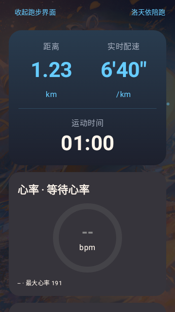
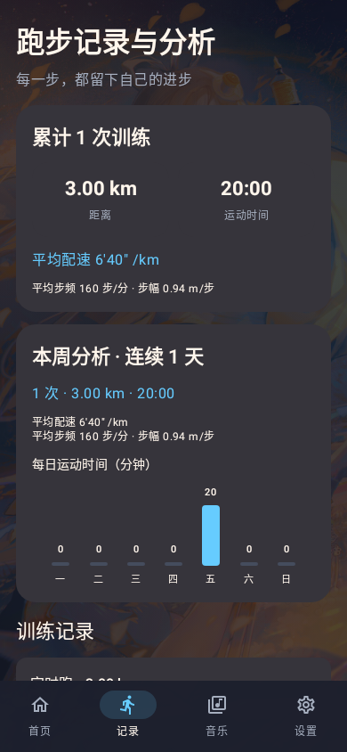
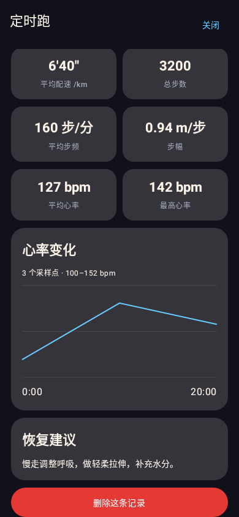

# 洛天依陪跑 · Android 原生版

洛天依语音、节拍器、音乐和运动记录，陪你迈出每一步。

基于 Cory 的 [洛天依陪跑](https://github.com/w8888-hh/luotianyi-running-app) 项目重写的 Android 原生版，使用 **Kotlin + Jetpack Compose** 开发。原生版作者：**绿卫**；原项目作者：**Cory**。

本仓库是原项目的 fork，保留上游代码和提交历史。原生版源码位于 [`android-native/`](android-native/)，独立使用 Room、DataStore 和 Media3。

**当前原生测试版：v0.1.8** · Android 8.0 及以上

[下载安装包](https://github.com/lvwei114/luotianyi-running-app/releases/tag/v0.1.8-native-test) · [v0.1.8 更新说明](android-native/docs/v0.1.8改进说明.md) · [原生版构建说明](android-native/README.md) · [原项目](https://github.com/w8888-hh/luotianyi-running-app)

## 安装与开始使用

1. 打开 [v0.1.8 Release](https://github.com/lvwei114/luotianyi-running-app/releases/tag/v0.1.8-native-test)，在 Assets 中下载 `.apk` 安装包。另附 SHA256 校验文件。
2. 安装后按需允许定位、身体活动、蓝牙和通知权限。记录距离需要有效 GPS；心率功能需要支持标准 BLE 心率广播的设备。
3. 在音乐页批量导入本地歌曲，创建或追加歌单。
4. 在首页选择跑法，点击“开始跑步”；也可以独立选择 5–60 分钟定时跑。完成后在“记录”页查看分析。

已安装此前同签名原生测试版的用户可覆盖更新；首次安装可能需要允许浏览器或文件管理器安装应用。测试包使用调试签名。

## 跑法

| 跑法 | 节奏与时长 |
|---|---|
| 跟天依跑 | 按歌单时长分配热身、燃脂、冲刺、放松四阶段，可调整阶段占比 |
| 天依跟你跑 | 根据有效心率调整训练区间，节拍渐进变化 |
| 自定义 BPM | 自由设置 60–220 BPM，跑步中可调整 |
| 定时跑 | 选择 5–60 整分钟，暂停不计时，到点结束 |

## 功能

- **独立跑步界面**：距离与实时配速并排且数字同字号，突出运动时间；可收起界面再返回，支持暂停、继续和结束保存。
- **GPS 与记录分析**：距离只取 GPS，定位缺失路段不补算；静止时实时配速显示 `--`。平均步频按总步数和有效运动时间计算，步幅使用 GPS 有效路段及对应步数。
- **记录页**：累计和本周统计、连续跑步天数、单次训练详情、心率曲线、恢复建议，以及带确认的红色删除按钮。
- **音乐与歌单**：批量导入本地歌曲，新建或追加歌单，BPM 匹配与检测，顺序／随机／心率智能播放，喜欢、移除与恢复，以及保存本次播放歌单。
- **心率与提醒**：标准 BLE 心率设备连接，最大心率与心率储备设置，心率提醒、补水提醒、随机鼓励语和高温模式。
- **洛天依语音与节拍器**：59 条本地语音按条件触发，配套字幕和分类试听，继续使用现有随机鼓励语频率；系统 TTS 回退，“天依说”固定在屏幕上方。引导跑与定时跑热身 150–160 BPM，各阶段及跑法切换平滑过渡。
- **首页与外观**：随本地时间变化的问候语、个人昵称、右侧连续天数与洛天依图标；内置图库、自选背景、头像和完整／简洁／省电效果档位，主题蓝色为 `#66CCFF`。
- **后台与本地保存**：运动前台服务、锁屏通知与音乐控制、中断训练恢复、保存失败重试；运动记录和个人资料保存在设备本机。

## 界面预览

以下为 v0.1.6 原生界面渲染图，训练数字为示例数据。

| 首页 | 跑步 | 记录与分析 |
|---|---|---|
|  |  |  |

| 记录详情 | 设置 |
|---|---|
|  |  |

更多截图见 [`android-native/docs/images/ui-cleanup/`](android-native/docs/images/ui-cleanup/)。

## v0.1.8 更新

- 全部 59 条本地语音接入对应触发条件和字幕，设置中可分类试听；补水、心率、长时间运动等提示满足条件才会播放。
- 引导跑和定时跑采用热身 150→160、燃脂 160→170、冲刺 170→175、放松 175→150 BPM，保持原阶段占比，消除交界处跳变。
- 切换跑法从当前 BPM 平滑过渡。运动前补水仍为一条固定录音，开场有三条随机语音，尚未加入跨次防重复。

版本 `0.1.8-native-test`，versionCode 9。63 项 JVM/Robolectric 测试通过；Lint 0 错误、17 条提示。安装包名称、版本、资源、完整性、SHA256 与 v2 签名检查通过，签名与 v0.1.7 一致，可覆盖安装。语音字幕与跟拍舒适度仍需真机验证。

### v0.1.7 更新

首页和文档中的相关名称统一为“定时跑”。版本为 `0.1.7-native-test`，versionCode 8；定时范围、跑法和计时逻辑保持原有行为。编译、打包及名称、版本、v2 签名校验通过，签名与此前原生测试版一致。本次仅文案和版本号调整，未重复运行 v0.1.6 的测试；v0.1.7 尚需真机复测。

### v0.1.6 更新

- 首页删除“本周记录”，增加时间问候、昵称和右侧连续天数。
- 底部“跑步”改为“记录”；跑步中的定位、步幅和步频卡片移除，记录页继续保留对应指标。
- 记录详情删除按钮改为通栏红色按钮，保留删除确认。
- 设置页删除“数据保存与迁移”模块及两段说明文字。
- 保留此前 GPS 静止配速修复、同字号距离与配速、原生版作者信息及应用图标。

版本为 `0.1.6-native-test`，versionCode 7。编译、39 项 JVM/Robolectric 测试和打包通过；Lint 0 错误、17 条提示，APK v2 签名与此前原生测试版一致。此前版本已获维护者真机验证反馈，**v0.1.6 仍需真机复测**。

## 开发与构建

准备 Android SDK Platform 36 和 JDK 17 或更新版本，使用 Android Studio 打开 `android-native/`；本项目开发验证使用 JDK 21。配置本机 `JAVA_HOME`、`ANDROID_HOME`，或使用不提交到仓库的 `local.properties`。

Windows PowerShell：

```powershell
cd android-native
.\gradlew.bat :app:testDebugUnitTest :app:lintDebug :app:assembleDebug --console=plain
```

Linux / macOS：

```sh
cd android-native
./gradlew :app:testDebugUnitTest :app:lintDebug :app:assembleDebug --console=plain
```

安装包输出到 `android-native/app/build/outputs/apk/debug/app-debug.apk`。自行编译的调试签名可能与发布包不同；覆盖安装需使用相同签名。

## 仓库目录

| 路径 | 内容 |
|---|---|
| `android-native/` | 本 fork 维护的 Android 原生版源码、测试和文档 |
| `android-native/docs/` | 版本更新、功能说明和原生界面预览 |
| `index.html`、`core/`、`legacy/`、`android/` 等 | 保留的上游 Web／Capacitor 项目 |
| `docs/README-upstream.md` | 原项目 README 存档；上游最新说明以原项目仓库为准 |

根目录 `.gitattributes` 将保留的上游代码和生成文件排除出 GitHub 语言统计，原生 Kotlin／Java 源码仍按实际语言统计。安装包通过 Releases 分发，构建缓存、个人数据与签名密钥不提交。

## 作者、来源与许可

- **原生版作者：绿卫**。
- **原项目作者：Cory**，哔哩哔哩：本人内心十分开朗。原项目：[w8888-hh/luotianyi-running-app](https://github.com/w8888-hh/luotianyi-running-app)。
- 代码采用 [MIT License](LICENSE)，分发时保留原有版权和许可声明。
- GPT-SoVITS 洛天依语音模型作者：只想干饭的麦克斯韦妖；模型项目：[xdedmmc2/GPT-SoVITS-Luo-Tianyi](https://github.com/xdedmmc2/GPT-SoVITS-Luo-Tianyi)。
- 内置语音、背景和相关资料沿用原项目；应用图标与首页洛天依图标由维护者提供。
- 洛天依声音与形象版权归上海禾念信息科技有限公司所有；代码许可证不改变图片、声音及其他资源的原有权利归属。

欢迎通过 [Issues](https://github.com/lvwei114/luotianyi-running-app/issues) 反馈问题，附上应用版本、手机型号、Android 版本及复现步骤。
