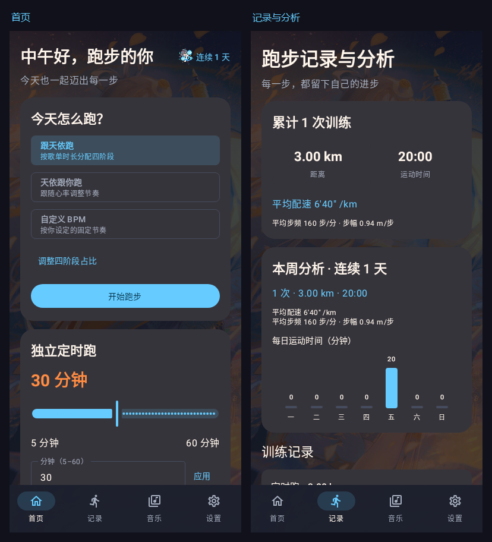
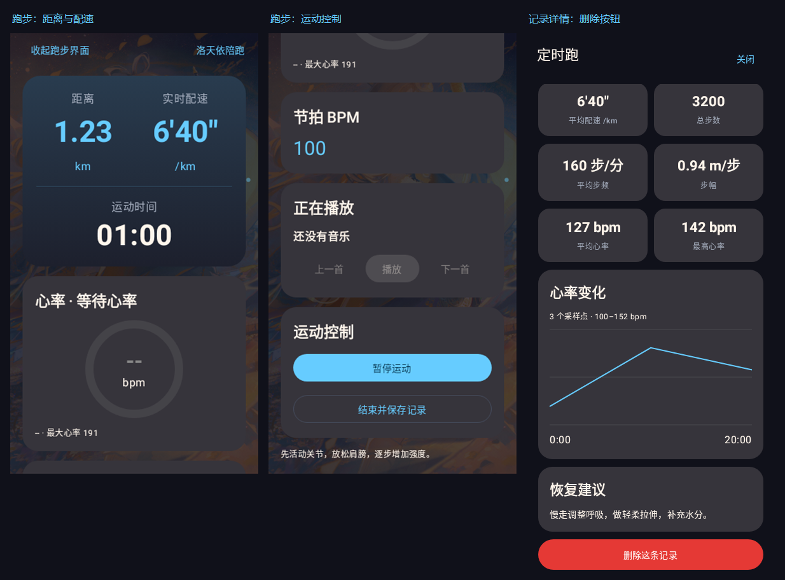
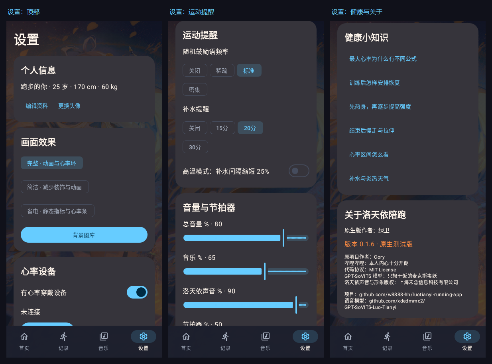

# 洛天依陪跑 · Android 原生版

基于 [Cory 的洛天依陪跑](https://github.com/w8888-hh/luotianyi-running-app) 重写的 Android 原生版。原生版作者：**绿卫**；原项目作者：**Cory**。

使用 Kotlin、Jetpack Compose、Room、DataStore 和 Media3。源码位于 fork 的 `android-native/`，支持 Android 8.0（API 26）及以上。

**当前测试版：v0.1.8** · `0.1.8-native-test` · versionCode 9

v0.1.8 接入全部 59 条本地语音及对应字幕，增加分类试听；热身节拍提升到 150–160 BPM，四阶段曲线与跑法切换采用平滑过渡。

[下载测试 APK](https://github.com/lvwei114/luotianyi-running-app/releases/tag/v0.1.8-native-test) · [更新说明](docs/v0.1.8改进说明.md) · [已发布版本](https://github.com/lvwei114/luotianyi-running-app/releases) · [功能清单](docs/功能迁移清单.md) · [fork 首页](https://github.com/lvwei114/luotianyi-running-app)

## 功能

- 引导跑、心率跟随跑、自定义 60–220 BPM 和 5–60 分钟定时跑，暂停不计时；引导跑和定时跑使用连续的四阶段 BPM 曲线。
- 独立跑步界面显示距离、实时配速和运动时间，支持收起、返回、暂停、恢复和保存记录。
- GPS_PROVIDER 记录距离，定位缺失路段不补算；静止时实时配速显示 `--`。平均步频按总步数和有效运动时间计算，平均步幅使用 GPS 有效路段及对应步数。
- “记录”页提供累计、本周、连续天数和单次训练分析，保留步频、步幅、心率曲线及带确认的删除操作。
- 批量导入歌曲、新建或追加歌单、BPM 检测、顺序／随机／心率智能播放、喜欢与移除／恢复、锁屏音乐控制和保存本次播放歌单。
- 标准 BLE 心率扫描与连接，心率区间、持续过高提醒与自动暂停、补水提醒、鼓励语和高温模式。
- 全部 59 条本地洛天依语音与匹配字幕、分类试听及系统 TTS 回退，复用随机鼓励语频率；固定在上方的“天依说”，木块／电子节拍器及四通道音量。
- 首页随本地时间切换问候语，显示昵称、连续跑步天数和维护者提供的洛天依图标。
- 内置图库、自选图片与头像，完整／简洁／省电效果档位，蓝色强调色 `#66CCFF`。
- 前台运动服务、中断训练恢复和保存失败重试；记录和设置保存在本机。v0.1.6 已移除设置页的数据保存与迁移入口。

## 预览







上述为 v0.1.6 的 Compose 原生界面渲染，训练数值为示例数据；v0.1.7 将定时跑名称和版本号更新。[界面调整说明](docs/界面精简改进说明.md) · [首页问候语说明](docs/首页问候语改进说明.md)。

## 构建

准备 Android SDK Platform 36 和 JDK 17 或更新版本，使用 Android Studio 打开本目录；开发验证使用 JDK 21。配置 `JAVA_HOME`、`ANDROID_HOME`，或在本机 `local.properties` 中设置 `sdk.dir`，不要将本机路径或密钥提交。

在本目录运行：

```powershell
# Windows PowerShell
.\gradlew.bat :app:testDebugUnitTest :app:lintDebug :app:assembleDebug --console=plain
```

```sh
# Linux / macOS
./gradlew :app:testDebugUnitTest :app:lintDebug :app:assembleDebug --console=plain
```

构建产物：`app/build/outputs/apk/debug/app-debug.apk`。APK 通过 GitHub Releases 分发，源码仓库排除安装包、构建缓存、个人 SDK 路径和签名密钥。

## 验证与安装

v0.1.8 已完成本地测试 APK 打包。同一功能代码在打包前通过 63 项 JVM/Robolectric 测试及 Lint 检查，Lint 0 错误、17 条提示。应用名、版本、59 条语音资源、APK 完整性、SHA256 和 v2 签名检查均通过，签名与 v0.1.7 一致，支持覆盖安装该版本；详见 [v0.1.8 更新说明](docs/v0.1.8改进说明.md)。语音字幕和跟拍舒适度仍需真机验证。

v0.1.6 的编译、39 项 JVM/Robolectric 测试、Lint 和打包通过，Lint 0 错误、17 条提示；检查了 390×844 和 360×640 界面渲染。APK 应用名为“洛天依陪跑”，使用与此前原生测试版一致的调试签名，可覆盖更新同签名版本。自行编译使用的签名可能不同。

v0.1.7 的编译、打包、名称、版本和签名校验通过；本次仅文案和版本号调整，未重复运行 v0.1.6 的测试。此前版本获得维护者真机验证反馈，v0.1.7 尚需真机复测。定位、身体活动、蓝牙和通知权限用于对应运动功能，心率设备需支持标准 BLE 心率广播。

[历史 bug 修复说明](docs/bugs修复说明.md)。

## 作者与资源

原生版作者：绿卫。原项目作者：Cory（哔哩哔哩：本人内心十分开朗）。代码采用 [MIT License](LICENSE)，保留原有版权和许可声明。

- 语音模型：[xdedmmc2/GPT-SoVITS-Luo-Tianyi](https://github.com/xdedmmc2/GPT-SoVITS-Luo-Tianyi)，模型作者：只想干饭的麦克斯韦妖。
- 内置语音、背景和相关资料沿用原项目；应用图标和首页图标由维护者提供。
- 洛天依声音与形象版权归上海禾念信息科技有限公司所有；代码许可证不改变相关资源的原有权利归属。
