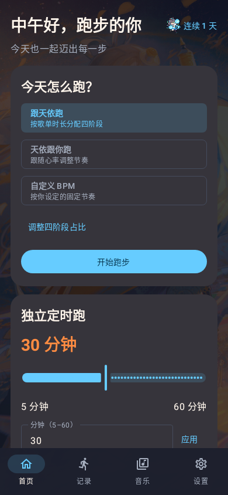

# 首页问候语与连续天数（方案 B，已包含在 v0.1.6）

- 首页大标题替换为“问候语，昵称”，昵称来自个人资料设置。
- 右侧显示用户提供的“图库/icon1.png”洛天依图标和蓝色“连续 n 天”，不增加新的统计卡片。图标以原色完整显示，尺寸 28dp，资源缩小为透明 128×128 PNG。
- 按手机本地时间切换：05:00–11:00 早上好；11:00–14:00 中午好；14:00–18:00 下午好；18:00–23:00 晚上好；其余时间夜深了。
- 首页在前台每 30 秒刷新时间，回到前台立即刷新。跨日及手机时区变化后重新计算连续天数。
- 连续天数复用记录与分析页的规则：按已保存训练的开始日期统计，同一天多次仅计一天；今天没有记录时，从昨天向前计算；没有连续记录显示 0 天。记录尚未加载时显示“连续 -- 天”。
- 保留原有跑法和定时跑，昵称过长最多显示两行并省略尾部，右侧连续天数保持独立。

预览由实际 Compose 原生界面渲染，连续 1 天为示例记录数据。

编译、39 项现有 JVM/Robolectric 测试、Lint 检查通过（0 错误、17 条提示）。已打包为 v0.1.6 并通过 QQ 发送到“我的手机”；GitHub 下载入口为 [v0.1.6 Release](https://github.com/lvwei114/luotianyi-running-app/releases/tag/v0.1.6-native-test)。现有 v0.1.5 安装包不包含这次更新。
